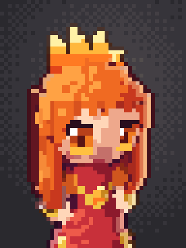
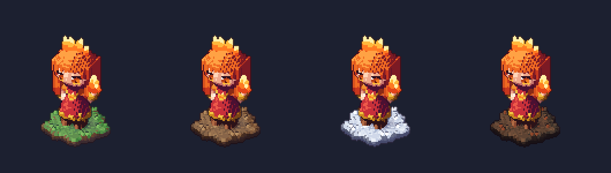

# Voxel chibi characters: how the voxel Lina was made

This is a reference record, not a pipeline the game uses. The game still draws 2D pixel sprites. Nothing here is wired into `client/`.
It records how one voxel hero was built so the method can be reviewed and best practices pulled from it: part categories, cosmetics,
materials, emissives and so on. Read the "Open questions" at the end first.


| File | What it is |
|---|---|
| `tools/art/vox.mjs` | Voxel kit (`Vox`, `mix`, `hex`) plus a CPU ray-cast renderer (`renderVox`, `Canvas`). No deps, no GPU. |
| `tools/art/heroes/lina_vox.mjs` | The model: `buildLina(pose)` and the pose library `ANIMS`. |
| `tools/art/terrain.mjs` | Swappable voxel ground patch: `withTerrain(model, { terrain })` and the presets in `TERRAINS`. |
| `tools/art/heroes/lina_vox_shot.mjs` | Showcase: big 3/4 view plus front / 3/4 / side / back, on a terrain → `docs/voxel-chibi/lina_vox[_<terrain>].png` |
| `tools/art/heroes/lina_vox_terrains.mjs` | Terrain swap check: same pose on every preset → `lina_vox_terrains.png` |
| `tools/art/heroes/lina_vox_poses.mjs` | Every `ANIMS` pose, one row per animation → `lina_vox_poses.png` |
| `tools/art/heroes/lina_vox_portrait.mjs` | 3/4 bust portrait with studio and rim lights → `lina_vox_portrait.png` (48x64, shown at 8x) |
| `docs/shots/v3-lina-sheet.png`, `docs/voxel-chibi/ref/` | The chibi reference: the v3 2D chibi Lina, as a sheet, a front / 3/4 / back zoom, and in game. |

Re-render everything with:

```
node tools/art/heroes/lina_vox_shot.mjs && node tools/art/heroes/lina_vox_shot.mjs snow
node tools/art/heroes/lina_vox_terrains.mjs && node tools/art/heroes/lina_vox_poses.mjs && node tools/art/heroes/lina_vox_portrait.mjs
```

## 1. Reference and target

- **Reference:** the v3 2D chibi Lina, chosen by the director as "the second chibi Lina" (`docs/shots/v3-lina-sheet.png`,
  `voxel-chibi/ref/v3-chibi-lina-zoom.png`, `voxel-chibi/ref/v3-chibi-lina-ingame.jpg`).
- **Look:** a voxel model that renders back to crisp pixel art. Each voxel lands on a few screen pixels. The shading uses the same
  4-step hue-shifted ramps as the 2D sheets, with a dark selective outline.
- **Proportions:** about 2.5 heads tall. The head plus the hair shell takes about 17 of the 44 voxels of height; the eyes are big and
  low on the face; the body is tiny. The silhouette carries the read: the hair mass, the flame crown and the hand flame.

## 2. Grid and axes

- `new Vox(34, 30, 48)`:
  - x = right as seen from the front
  - y = depth; **the model faces -y**
  - z = up
- The feet stand on z = 0 and the character is centred at (17, 15).
- A voxel is one material id (`Uint8`, so at most 255 materials per model). Id 0 means empty.
- **Budget used:** about 44 voxels tall and about 20 wide at the hair. That is enough for a 3x4 eye with lash, iris, pupil and shine.
  A smaller grid loses the face first.

## 3. Building blocks (the kit)

Every part is built from these primitives. A material argument can also be a function of the cell centre, `(px, py, pz) => id`. That is
how strands, bands and trims are made inside one primitive.

| Primitive | Use |
|---|---|
| `v.each(x0,y0,z0,x1,y1,z1, f)` | Signed-distance style volume: `f` returns an id or `undefined` per cell centre. Used for skirt cones, the torso, hair curtains and flame tongues. |
| `v.ellipsoid(cx,cy,cz, rx,ry,rz, m, only?)` | Head, hair shell, sleeves, hands. `only` is a mask, e.g. "not in the face window". |
| `v.capsule(a, b, r0, m, r1?)` | Limbs (tapered), the neck, bracers, boot cuffs. |
| `v.paintFront(x, z, m)` | Recolours the front-most voxel of a column. Used for all face detail and the chest emblem: a decal painted on the surface. |

**Order matters.** Later writes overwrite earlier ones:

1. Body
2. Hair shell
3. Skin face window carved back in
4. Painted details last

## 4. Parts taxonomy (as built)

| Category | Part | Built with | Notes |
|---|---|---|---|
| **Feet** | boots | `each` box with rounded toe cut-outs, z 0-3.6 | `legs:[dyR,dyL]` slides each foot along y and lifts it (`|dy| * 0.35`) for the walk. |
| | boot cuff | gold capsule at z ≈ 4 | Trim band that separates boot from leg. |
| **Legs** | legs | skin capsules z 3.5-8 | Short; mostly hidden by the skirt. |
| **Torso** | skirt | flared cone `each`, z 5-13 | Gold hem shell plus a scalloped band (`cos(angle * 9)`). |
| | belt | gold layer at z 12-13 | |
| | bodice | elliptic cross-section `each`, z 12-19.5 | Gold V trim computed in the same function. |
| | sleeves | 2 ellipsoids at the shoulders | Puffy and a lighter orange than the dress, to separate the arms from the body. |
| | neck | skin capsule | |
| **Arms / hands** | upper arm, forearm | 2 tapered capsules per arm | `arm(shoulder, elbow, hand)`. Poses come from a table (`ARMS`): `raise`, `back`, `thrust`, `cast`, `down`. |
| | bracer | gold capsule along 35-72 % of the forearm | |
| | hand | skin ellipsoid | No fingers at this scale. |
| **Head** | skull / face | skin ellipsoid r (8.1, 7.3, 7.7), centre z 28 | Only the "face window" of it stays visible. |
| | face window | mask: front of the head, under the fringe line | `faceWin()` decides hair vs skin. |
| **Hair** | shell | ellipsoid one voxel larger than the skull, minus the face window | Strand stripes: `hairD` on every 3rd column. |
| | fringe | per-column bottom heights (`bang[]`) | A hand-tuned jagged line, the biggest single likeness lever. |
| | side curtains | `each` slabs in front of the shoulders, pointed tips | `sway` shifts the tip pattern (idle hair motion). |
| | back mass | `each` to the waist with a jagged hem | |
| **Face** (painted) | eyes | `paintFront` rows z 23-27, 3 wide | Rows, top to bottom: lash, then shine + dark iris, iris + pupil, iris + pupil, light iris. Outer lash wing. `eyes: 'shut' | 'x'` repaint them. |
| | blush, mouth | 2-voxel paints | |
| **Cosmetics / attributes** | flame crown | 5 flame tongues on top of the head (`crownK`) | Hero signature. Emissive. |
| | hand flame | 3 tongues on the raised hand (`flameK`, 0 = none) | Shows the hero's element. Emissive. |
| | chest emblem | 5 painted voxels | Small flame mark. |
| | gold trim | hem, belt, V trim, cuffs, bracers | One shared `gold` material ties the outfit together. |

Flames all use one recipe: a cone per tongue whose radius shrinks with height (`w * (1 - f)^0.75`), bent sideways by
`sin(f * 3.2)`, and coloured by height along a 4-step emissive gradient (`f1..f4`) with a hotter core. `flick` scales each tongue by
±12 % with a phase per tongue, so the frames flicker without the silhouette jumping.

## 5. Materials

`v.mat(name, def)` returns an id. There are two kinds:

- **Lit:** `{ ramp: [dark, mid, light, highlight] }`
  - Light, self-shadow and AO pick one of the 4 steps through `levels` (thresholds).
  - The ramps are hue-shifted: shadows go to purple / crimson, highlights to warm yellow, never plain black or white.
  - `noShadow: true` keeps the material out of the ray-cast self-shadow. Skin uses it, so the face is never cut by the hair's shadow.
- **Emissive:** `{ emit: '#hex' }`
  - Flat colour, unaffected by lighting, never shaded. Used for eyes, flames, the mouth and the lashes, the parts that must read in any light.
  - The renderer has no bloom. The "glow" is only the colour staying full-bright.

| Name | Kind | Used for |
|---|---|---|
| `skin` | ramp, noShadow | face window, neck, legs, arms, hands |
| `hair`, `hairD` | ramp | hair shell and strands (2 tones = strand stripes) |
| `dress` | ramp | skirt, bodice |
| `sleeve` | ramp | puffy sleeves |
| `gold` | ramp | every trim: hem, belt, V, cuffs, bracers |
| `boot` | ramp | boots |
| `blush` | ramp | cheeks |
| `lash`, `pupil`, `mouth` | emit (dark) | face lines that must not shade away |
| `irisD`, `iris`, `irisL`, `shine` | emit | eyes (dark to light iris plus a white catch-light) |
| `f1`..`f4` | emit | flame gradient, outer to core |

Outlines come from the material: each material gets `ol`, its dark ramp step mixed toward deep purple. The renderer draws the silhouette
outline and depth-break interior lines in that colour, so a red part gets a dark-red line and not a black one.

## 6. Poses (`ANIMS`)

A pose is a plain object passed to `buildLina(p)`. The whole model is rebuilt per frame; there is no skeleton.

| Field | Range | Effect |
|---|---|---|
| `flick` | 0..3 | flame flicker phase (hand and crown) |
| `sway` | 0..1+ | hair tip pattern phase |
| `legs` | `[dyR, dyL]` | foot swing along y (+ = back) with lift |
| `arm` | `raise`, `back`, `thrust`, `cast`, `down` | right-arm elbow and hand table; `cast` raises both arms and moves the flame overhead |
| `flameK` | 0..2 | hand flame size; 0 = none |
| `crownK` | ~0.7..1.25 | crown height |
| `eyes` | `open`, `shut`, `x` | face state |

The library: idle 4, walk 4, attack 3, cast 3 and stunned 2 frames (`voxel-chibi/lina_vox_poses.png`).


## 7. Renderer (`renderVox`)

- Orthographic or perspective ray-cast per output pixel (Amanatides-Woo DDA), with `ss` x `ss` supersampling by majority vote.
- **Normals:** a smooth per-voxel normal (occupancy gradient in a 5³ box). The blocks shade like a rounded form, while the edges stay voxel-crisp.
- **Lighting:** a key light in camera space, a shadow ray toward it, and an AO term.
  - The result goes through `levels` to choose a ramp step: stepped, not smooth.
  - `ambient` sets the floor.
- `fill: [r, u, v, k]` adds a second, unshadowed studio fill light.
- `rim: [{ dir, col, w, k }]` adds a screen-space rim light: a coloured band of `w` px on the silhouette side facing the back light.
- **Outlines:**
  - `outline` draws the selective silhouette in the material's `ol` colour.
  - `lines` sets the depth-break threshold for interior lines, e.g. hair over face or arm over body.

| Shot | Settings |
|---|---|
| Showcase | yaw 28, pitch 30, scale 2, ss 3, ortho. Default key light from top-left-front. |
| Portrait | 48x64, yaw -20, pitch 8, `fov: 39.6`, for the "studio, 50 mm" brief. 39.6° is the *horizontal* angle of a 50 mm lens on full frame, used here as the vertical fov, so the framing is a bit wider than a true 50 mm (that would be about 27°). |

Portrait lighting:

- key light from the left
- warm fill light from the right
- warm rim light (2 px) and cool rim light (1 px) from behind
- Bayer-dithered warm-grey backdrop falling off to charcoal



## 8. Terrain reference (`tools/art/terrain.mjs`)

Taken from the vox-preview grass patch and kept so the ground can be swapped later.

- `withTerrain(model, { terrain, R })` copies the model into a larger grid and puts a 3-voxel-thick round slab under the feet:
  - wobbly edge
  - hash-noise top in 5 tones
  - two dirt layers on the sides
  - sparse raised tufts away from the feet
- The contact shadow is **baked** into the top colours as a 3-level Bayer-dithered blob. Terrain materials are `noShadow`, so the baked
  shadow is the only one.
- It returns `{ v, dz, pad }`: the model is shifted by `pad` in x / y and by `dz` up, so add those to the camera centre.
- **To add a ground,** add an entry to `TERRAINS` with these keys:
  - `top`: 5 colours
  - `side`: 3 colours
  - `shadow`: shadow tint
  - `light`: highlight tint

  Presets so far: `grass`, `dirt`, `snow`, `dire`.



## 9. Lessons from building her

- **Likeness:** the fringe line, the eye block (size, lash wing, shine position) and the hair-curtain silhouette did most of it.
  Body detail barely shows at game size.
- **Hair:** carving a face window out of a hair shell beats building the hair from strands. The read is cleaner and costs fewer voxels.
- **Painting:** painting details on the front-most voxel (`paintFront`) is fast and keeps the surface flat. It only works for parts
  that face -y.
- **Emissives:** `emit` for the eyes and flames keeps them readable in any lighting. Skin needs `noShadow`, or the hair shadow
  makes the face look dirty.
- **Poses:** rebuilding the model per pose is simple and fast enough offline, a few ms per model. There is no rig, so parts can't be reused
  across heroes yet.
- **In game:** putting this model in the game as a 3D voxel mesh was tried and dropped. It read tiny and flat from the game camera. Don't
  assume the offline renders show the in-game look.

## 10. Open questions (for the best-practice review)

1. **Parts library:** what should it look like? For example, shared `head`, `hairShell(faceWindow, fringe[])`, `eyes(style)`,
   `hands`, `feet(type)`, `skirt / torso(cross-section)` and `flame(tongues)` builders with per-hero parameters, instead of one function per hero.
2. **Attachment points:** should there be named sockets (hand R / L, head top, back, chest) so cosmetics and attributes (crown, weapon,
   emblem) can be swapped?
3. **Materials:** should ramps come from a shared library, e.g. skin tones, gold, cloth families, so heroes share a palette with the
   2D art?
4. **Emissive tiers:** how many? For example eye, signature element and spell, with a glow strength each if bloom is ever added.
5. **Grid budget:** is a fixed size per hero class sensible, e.g. 34x30x48 for chibi heroes and smaller for creeps?
6. **Animation:** should poses stay data-only (as `ANIMS`), or move to a small rig: joint table plus capsules?
