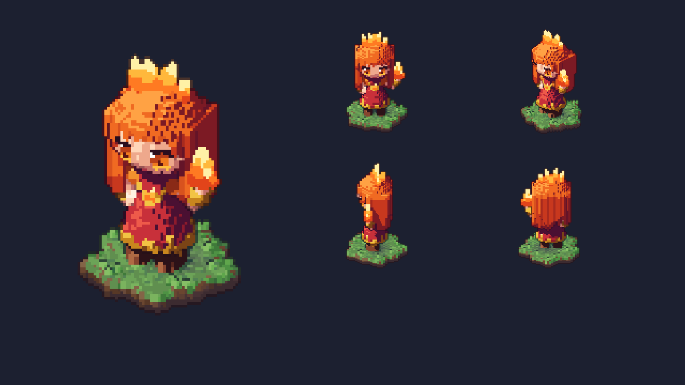
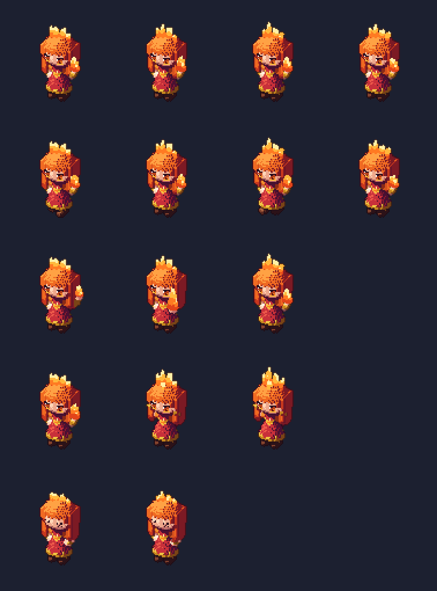
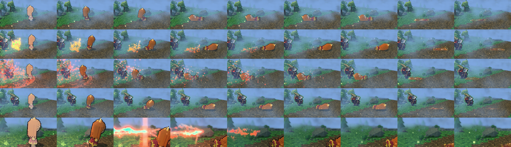
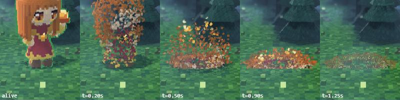

# Voxel units: kit, runtime, rules

Every unit, building, tree, clutter prop and the terrain is voxel. FX, particles, projectiles and telegraphs are not. Item and ability icons stay
pixel sprites. Lina (`shared/vox/heroes/lina.js`) and the melee creeps (`shared/vox/creeps/melee_radiant.js`, `melee_dire.js`) are the samples. To add one, see
[EXTENDING.md](EXTENDING.md#add-a-hero).



## Files
| File | Role |
|---|---|
| `shared/vox/vox.js` | Grid primitives: `Vox`, `each`, `ellipsoid`, `capsule`, `paintFront`, `mix`, `hex`, `smoothNormal`. |
| `shared/vox/mats.js`, `rig.js`, `parts.js`, `poses.js` | Kit: materials, rig classes, part builders, pose libraries. |
| `shared/vox/heroes/*.js`, `creeps/*.js` | Models (params files on the kit). |
| `shared/vox/terrain.js` | Ground materials shared by the game terrain and the offline ground patch (`TERRAINS`). |
| `client/src/render/voxmesh.js` | Mesher: `meshVox` / `buildVoxFrames` -> compact geometry + footprint per frame (layout in the file header). |
| `client/src/render/voxactors.js` | Game draw: `VOX_UNITS` registry, instancing, light, outline, lean, team tint, death. |
| `tools/art/vox.mjs` | CPU ray-cast renderer (`renderVox`) for offline sheets. No GPU. |
| `shared/vox/index.js` | Registry `VOX = { short: { kind, unit, mod } }`: one line per model; the tools and `voxmesh.test.js` iterate it. |
| `tools/vox/ref.mjs <short|npc key|all|heroes|creeps|neutrals|buildings|props|list>` | Private Dota 2 reference of any game unit (all heroes, creeps, neutrals, Roshan, couriers, wards, buildings, and ~70 static WORLD props `prop_<group>_<name>_<radiant|dire|any>`: trees, stumps, cliffs, rocks, clutter, water edge, views + sheet only; `tools/.cache/ref/<short>/`, gitignored): `sheet.png` (overview), `views.png` (5 views), `poses.png` (idle, run, attack, cast, stunned, death x 4 frames), `ref.json` (sizes, palette, sequences). |
| `tools/vox/brief.mjs <short>` | Agent brief: ref proportions + palette, grid class, kit, files, checklist. |
| `tools/vox/check.mjs <short|all>` | Kit contract + mesh checks (wraps `voxmesh.test.js`); `all` adds the rig classes. |
| `tools/vox/shot.mjs <short|all> [--small]` | Review sheet: 4 views, every pose, true size next to Lina -> `docs/voxel-chibi/<short>_vox.png` (`--small`: fast views in `tools/art/out/`). |
| `tools/vox/portrait.mjs <short>` | HUD portrait (32x42) -> `client/src/art/portraits/<short>.js` + a 12x preview (library: `tools/art/vox_portrait.mjs`). |
| `tools/vox/view.mjs <short> [--ref|--vox] [--poses]` | One compare PNG (reference rows over voxel rows, same views / anims) -> `tools/.cache/view/<short>.png`, gitignored, never committed. |
| `tools/art/heroes/lina_vox_shot.mjs` | Lina-only showcase sheet (terrain patch). |
| `docs/shots/v3-lina-sheet.png`, `docs/voxel-chibi/ref/` | The chibi likeness reference (v3 2D Lina). |

## Workflow
Skill `.claude/skills/vox-unit/SKILL.md` (one or many units per run): `npm run vox:ref -- <unit>` -> read `sheet.png` (then `poses.png` for `ANIMS`; `vox:brief -- <short>` condenses them with the kit) -> signature
reads -> model file + registry line -> `vox:check` -> `vox:shot -- <short> --small` (<= 3 fix rounds) -> full `vox:shot` (or `vox:view -- <short> --poses`, skill `vox-view`) to the creative director -> register in `VOX_UNITS`, portrait (heroes), done.

## Spell FX reference (`tools/fx/`)
The director approves each ability from a sheet with the OG Dota 2 FX on top and ours below. Output lives in the gitignored `tools/.cache/ref/<hero>/fx/`; numbers and colours read from `ref.json` may go into code.
- `npm run fx:ref -- <hero> [ability ...]` (`--list` shows the mapping only) reads the local game files. The particle list comes from the ability's KV `precache` block when it has one, else from file names in the hero's particle folders (`mapping.source`; no built-in ability has a precache block today). Per ability it writes `<ability>/`:
  - `ref.json`: `tree` (every root system -> children, with delay and the control points it uses), `palette` (6-8 colours), per-system emitters, renderers, lifetimes, rates, radii, fades, colours, textures, light colours, and `ambiguous` mapping notes.
  - `tex/*.png` (frame 0 of each texture), `og.png` (CPU preview + textures + params table) and `cpu_<t>.png` (bare CPU preview frames). The CPU preview is approximate (`preview.cannot`).
- OG frames: real-game captures in `<ability>/cap/og_0.1.png`, `og_0.4.png`, `og_1.0.png` (s after the cast event, close-up) and `og_game.png` (game camera at 0.4 s), written by `tools/fx/render/`.
- `npm run fx:view -- <hero> [ability ...]` fires `__fx.fire(key)` from `client/src/fxdemo.js` in headless Chrome (Ultra, day, no DoF, sim stepped at 30 Hz, own ports vite 5310 / CDP 9340) and writes `sheet.png`: per ability a 1580 x 469 block, OG row (`cap/`, else the CPU frames labelled APPROXIMATION), palette strip, OURS row, each `0.1 / 0.4 / 1.0 s close-up + game cam`. Close-up: distance 550, pitch 60, aimed 200 u short of the dummy (unit / point target; the dummy stands 640 u east of the caster) or at the caster. Ours are kept as `ours_<0.1|0.4|1.0|game>.png`.
- Hero agent loop: `fx:ref` -> read `ref.json` and the OG frames -> build the FX on `render/fx/geo3d.js` -> `fx:view -- <hero> <ability>` -> fix -> hand `sheet.png` to the director. If an ability has no or a wrong mapping, extend `ALIAS` in `tools/fx/lib/vpcf.mjs`.

## Grid and densities
- Axes: x = right seen from the front, y = depth (**the model faces -y**), z = up. Feet on z 0, centred on `META.cx, cy`.
- One material id per voxel (`Uint8`, 0 = empty, max 255 mats per model).
- **Characters 4.2 world units per voxel, world 8.4** (exact 2:1). Size a model by voxel count, never by scaling `unit`. Proportions follow Dota:
  creep < hero < Roshan; a tower is about 3 heroes tall.
- Grids: hero 34x30x48 (~44 tall), creep ~30x30x34 (~25-29 tall; room for weapons in every pose), big neutrals / Roshan larger. The face goes first on a smaller grid: a hero needs room for a
  3x4 eye (lash, iris, pupil, shine).

## Model contract
```js
export const META = { rig, grid: [X, Y, Z], cx, cy };
export function build(pose) { /* -> Vox */ }
export const ANIMS = { idle, walk, attack, cast /* optional */, stunned };   // arrays of poses; no death anim
```
Write order matters (later wins): body, hair shell / helmet, skin carved back into the face window, painted details last. A material argument may be a
function of the cell centre `(px, py, pz) => id` (strands, bands, trims).

## Rig (`rig.js`)
`solve(cls, P, pose)` -> `{ J joints, T rigid body transforms, socket(name) -> { p, dir, T } }`. Side R = the character's right = -x. `P` overrides
class proportions (`hipZ`, `shX`, `shZ`, `upper`, `fore`, `thigh`, `shin`, `headZ` ...).

| Class | Joints | Sockets | Use |
|---|---|---|---|
| `biped` | 22: root, hips, chest, back, neck, head, headTop, hairSway; shoulder / elbow / hand, hip / knee / ankle / foot R L | handR, handL, headTop, back, chest | heroes, humanoid creeps |
| `quad` | 23: chest, pelvis, withers, neck, head, jaw, headTop, tail1-3; shoulder / knee / foot FR FL, hip / knee / foot BR BL | headTop, back, chest, mouth | wolves, hounds |
| `flyer` | 22: body, chest, neck, head, headTop, jaw, tail1-3; wing R L x3; hip / foot R L | headTop, back, chest, mouth | hovers at `P.fly` above the ground point `root` |
| `big` | biped (or quad via `P.base`) x `P.scale` 1.6, hunch 12 deg | as base | golems, Roshan |

Pose channels (all optional): `bob`; `spine` / `head` / `body` `[pitch, yaw, roll]`; limbs `armR` ... `[el, hd, k]` (elevation, heading 0 = sideways
90 = forward, stretch); IK `footR` ... / `reachR` ... `[dx, dy, dz]`; `shrug {R, L}`; `pin {joint: [x, y, z]}` (exact joints, e.g. Lina's arms);
`jaw`, `flick` (flame phase), `sway` (hair), `eyes` (`open` / `shut` / `x`).

## Parts (`parts.js`), each `(v, T?, opts, mats)`
| Group | Builders |
|---|---|
| Volumes | `vol`, `ell`, `cap`, `obox`, `disc`, `decal`, `stripes` |
| Limbs | `limb` (tapered capsule chain), `band`, `hand`, `feet` (`boot`, `bare`, `hoof`, `paw`) |
| Body | `torso` (cross-section fn), `skirt`, `pauldron` |
| Head | `faceWindow` (fringe line), `head`, `hairShell`, `helmet`, `eyes` (`big`, `dot`), `mouth` |
| Signature | `flame` (tongues over 4 emissive steps) |
| Held | `weapon` (`sword`, `club`, `spear`, `axe` at a hand socket), `shield`, `bow` (recurve, emissive tips) |

## Materials (`mats.js`)
`useMat(v, name, { from, ...overrides })`. Heroes pick by name and override only signature colours.
- **Lit** `{ ramp: [dark, mid, light, highlight] }`, hue-shifted (shadows to purple / crimson, highlights warm, never black / white). Outline = the dark step
  toward deep purple. `noShadow` on skin (hair shadow makes the face dirty).
- **Emissive** `{ emit, tier, gain? }`, never shaded. Tiers give the starting gain: `eye` 1.0, `signature` 1.2, `spell` 1.6. A hero may tune its own
  glowing parts with `gain` (Invoker's orbs, Rubick's staff tip, Lina's flames); every gain is capped to `EMIT_RANGE` 0.5-1.8 so bloom never whites out.
  The registry option `night` (voxactors.js) adds that share of gain to a unit's emissives at full night (Forged Spirit 0.25).
- `team: true` = tinted per instance (creeps, buildings; never heroes).
- Library: skin (`skin`, `skinPale`, `skinTan`, `skinDeep`, `skinGreen`, `blush`), metal (`gold`, `silver`, `steel`, `iron`, `bronze`), `leather[L]`,
  cloth (`clothRed` ... `clothBlack`), `wood[Dark]`, `stone`, `bone`, team (`teamCloth`, `teamMetal`), face (`lash`, `pupil`, `mouth`, `shine`, `eyeDot`,
  `eyeGlow`), `useIris(v, amber | ice | green | violet)`, `useFlame(v, 'fire' ...)` -> `f1..f4`.

## Poses (`poses.js`)
`LIBRARY[cls](opts)` -> `{ idle 4, walk 4, attack 3, cast 3, stunned 2 }`; `withPoses(anims, { attack: [{}, {...}, {}] })` overrides frames. Options:
biped `stride lift bob swing hold guard blade`; quad `stride lift bob wag`; flyer `flap bob`; big = biped (overhead slam). Small grids tune the strike per
model.



## Runtime (`voxmesh.js`, `voxactors.js`)
- **Registry:** `VOX_UNITS[key] = voxEntry(mod, { unit, max, lean })`; `voxNameOf(unitKey)` maps both teams' lane creeps to one entry. Built lazily on a
  unit's first `add()`.
- **Mesh:** one quad per exposed face, one geometry per pose frame, one shared index buffer. 12 B / vertex (Int8 position + face byte, Int8 smooth normal
  + hash, Uint8 colour + emit gain). Lina: 16 frames, 2.4 MB GPU, ~160 ms build. Budget **< 3 MB per hero**.
- **Light:** the `buildings3d.js` path (shadow map, key + point lights, Bayer-quantised, fog grade); key term `.3 + .55 N.L` keeps the shaded side readable.
- **Lean:** characters tilt about the feet by `max(0, camPitch - 30 deg)` so the camera sees them at the offline ~30 deg. **Shadow passes lean too**, or the
  head shadows the face. Buildings `lean: false`.
- **Outline:** screen-space, silhouette only (`post.js` OUTLINE). Each instance writes an id + line colour into an ID target (`idScene`); a 2 px line (`OUTLINE_PX`)
  goes where the id changes, on the outer side of the nearer unit, at its depth. Inner depth steps never get a line. Dark by default, hover /
  selection colour when set; flying death voxels carry no id. Buildings share the pass (`buildings3d` `idGroup`). Setting `outlines`. Portraits match: `vox_portrait.mjs` `lines: 0`.
- **Depth:** foot depth (`propDepth`) while sprites remain; real depth after batch 7.
- **Team tint:** the face byte's team bit swaps hue to `TEAM_COL[team]`, keeping ramp luminance.
- **Footprint:** per-frame voxel bounds size the pick box, HP bar height and decal radius (decal from the idle frame).
- **Anims:** `channel` -> `cast`; `idle`, `walk`, `stunned` loop, the rest clamp.
- **Death:** the shader rebuilds each voxel centre from the face byte and breaks the model apart over `DIE_T` 1.45 s (hop, gravity, one bounce, tumble,
  Bayer fade; shadow follows). Holds the first `stunned` frame. The debris follows the spell wind (`WIND_*` in the shader, same gust uniforms as the trees).
- **Hero ragdoll:** heroes first ragdoll for `RAG_T` 2 s, then dissolve from the settled pose. `ragdoll.js` runs a CPU verlet body (10 particles: torso rigid, head,
  hands, ankles as rods; no hip/knee joints) and writes one rigid transform per segment to the `uRag` texture; the shader moves each voxel with its
  segment (face byte bits 5-7, baked from the nearest rig bone capsule; a model needs `rigOf(pose)` -> joints in its entry). Launch = `launchAt` (wind.js) at the feet
  at death, else a small knock away from the killer, else a plain collapse. Creeps skip the ragdoll.





## Rules
1. **Likeness lives in a few params:** fringe line, eye block (size, lash wing, shine), hair-curtain silhouette, one signature part. Body detail barely shows.
2. **Hair = a shell with a carved face window**, not strands. Paint face details with `paintFront`.
3. **Emissive only for eyes and signature / spell parts**; tiers are the default, each hero may tune its own.
4. **No runtime skinning:** frames are rebuilt per pose at load. Sway (`aSw`, trees today; planned for hair / capes) is the only vertex animation.
5. **Every model has checks:** one line in `shared/vox/index.js` and `npm run vox:check -- <short>` covers it (feet on z 0, off the walls, winding, footprint, tiers, memory).
6. **Director gate per model:** an offline sheet + an in-game shot to the creative director before registering. Never self-certify visuals.
7. **Reference:** `tools/vox/ref.mjs` renders the local game files into the gitignored `tools/.cache/ref/`. `.vox` (MagicaVoxel) import only for one-off props.

## Conversion order
One director gate per batch, with in-game shots.

| Batch | Scope | State |
|---|---|---|
| 0. Foundation | Compact mesher, lazy build, registry, footprint, kit, tiers, team tint, death, CI checks | done |
| 1. Lane creeps | Melee, ranged, siege: Radiant and Dire are separate models after the Dota 2 ones (no team tint); `max` >= 64 per frame | melee Radiant + Dire drafted, awaiting the director gate |
| 2. Buildings | Tower, barracks, fort, fountain, shop, lantern, filler; `lean: false`; rubble on destroy | |
| 3. Heroes | The 12 after Lina | Invoker (blond swept-back mane, low collar) + Forged Spirit (emissive lava body) revised, awaiting the director gate |
| 4. Neutrals + Roshan | 21 neutrals + Roshan across the 4 rigs | |
| 5. Trees + clutter | Trees, 15 clutter variants | Drafted, awaiting the director gate. Trees: `shared/vox/world/trees.js` (side = `tileSide`, Dota name = silhouette family); `trees3d.js` greedy instanced, LOD1 + coarse shadow casters, cut = voxel dissolve onto the stump. Clutter + rocks: 13 variants, Radiant / Dire shapes (`shared/vox/world/{clutter,rocks}.js`), greedy-meshed, half-res LOD past 900 from the eye (tufts / ferns stay cubes) |
| 5b. Cliffs | Stepped stone aprons and wall slabs on the 8.4 cell grid (`shared/vox/world/cliffs.js`, emitted by `terrainGeo`), Radiant / Dire wall tint, merged flat tops; visual only (heights, pathing unchanged) | drafted, awaiting the director gate |
| 5c. Water edge | Cell-snapped stone curbs stepping into the SSR water at banks (same builder) | drafted, awaiting the director gate |
| 6. Portraits | `npm run vox:portrait` for every hero | Lina done |
| 7. Sprite removal | Delete `?vox=0` / `?voxt=0`, the sprite unit path (`actors.js` / `sprites.js`), body / world sheets and generators, painted portraits, the tile atlas terrain path; switch to real depth | |
